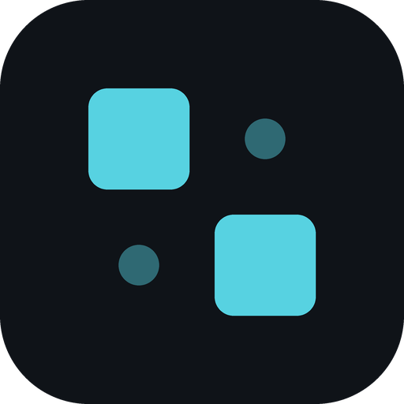
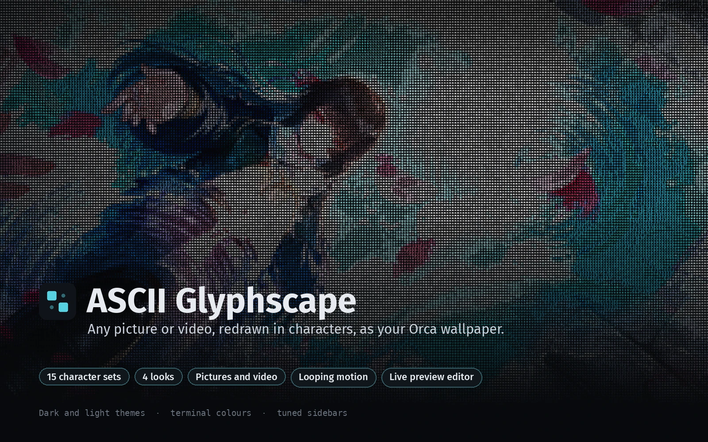
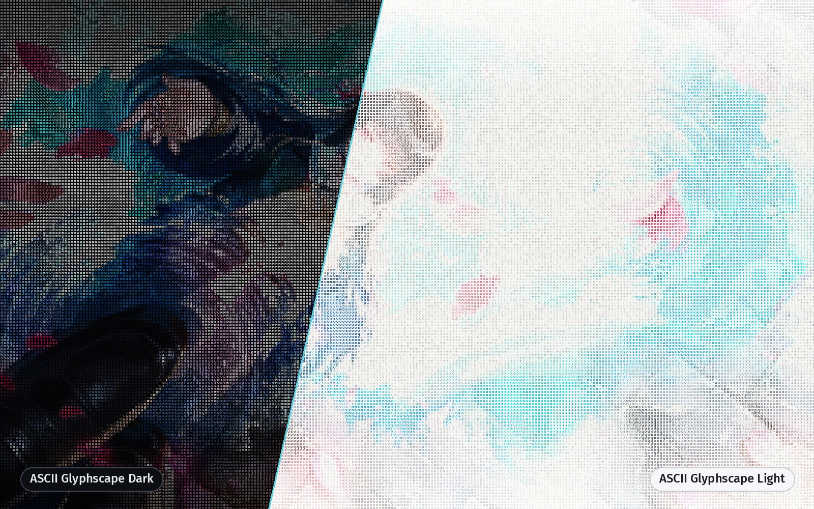
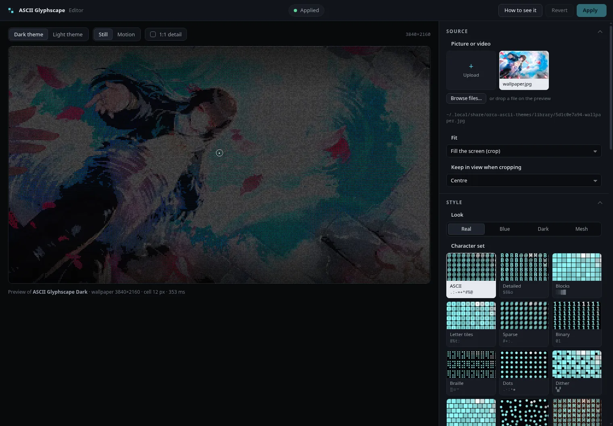
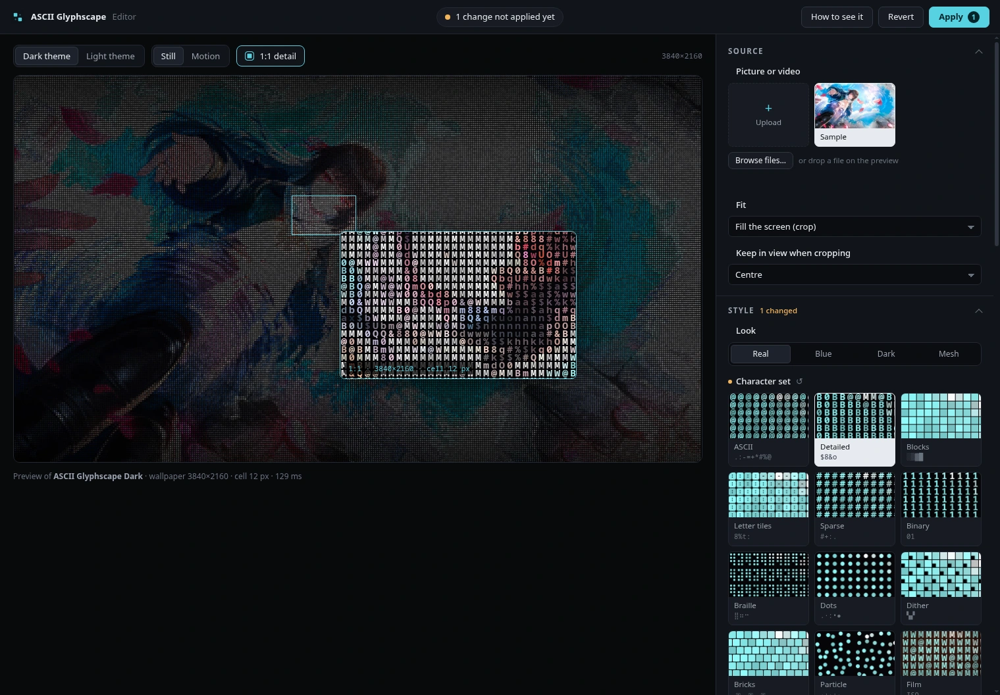
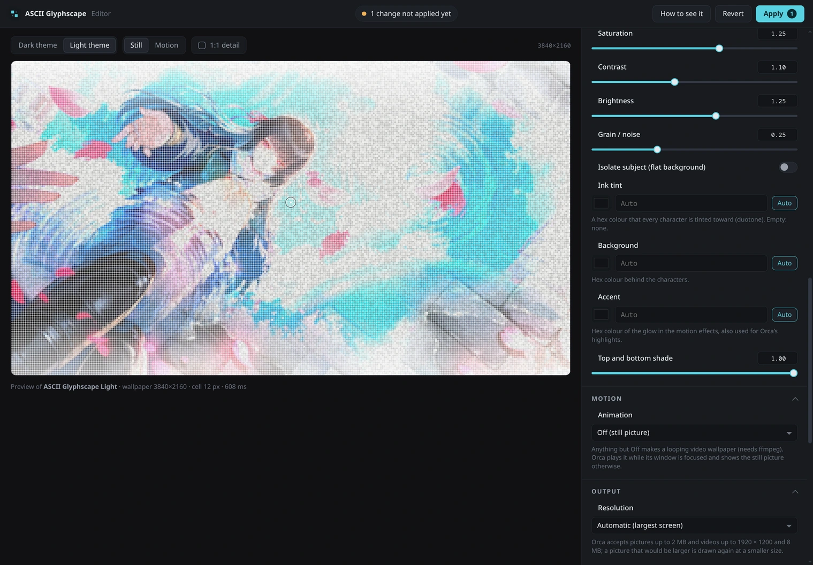
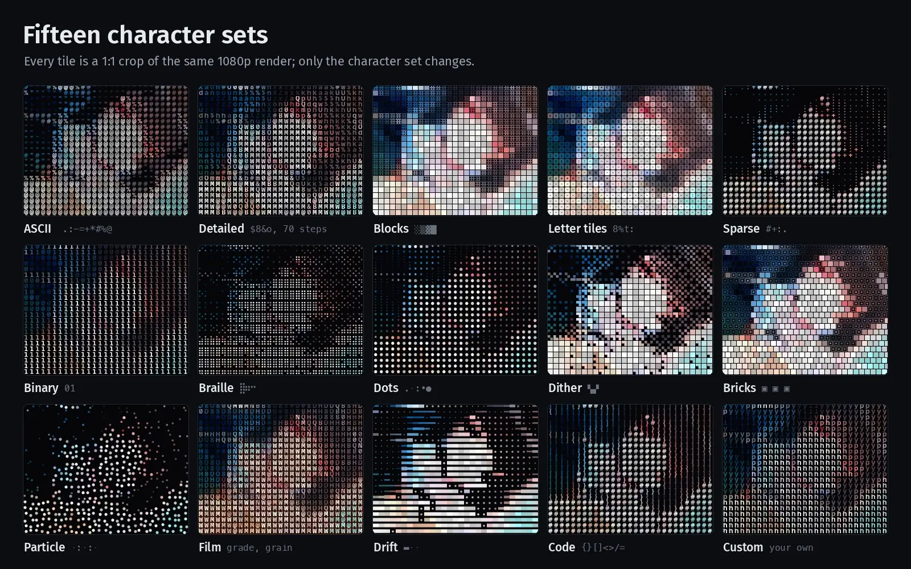
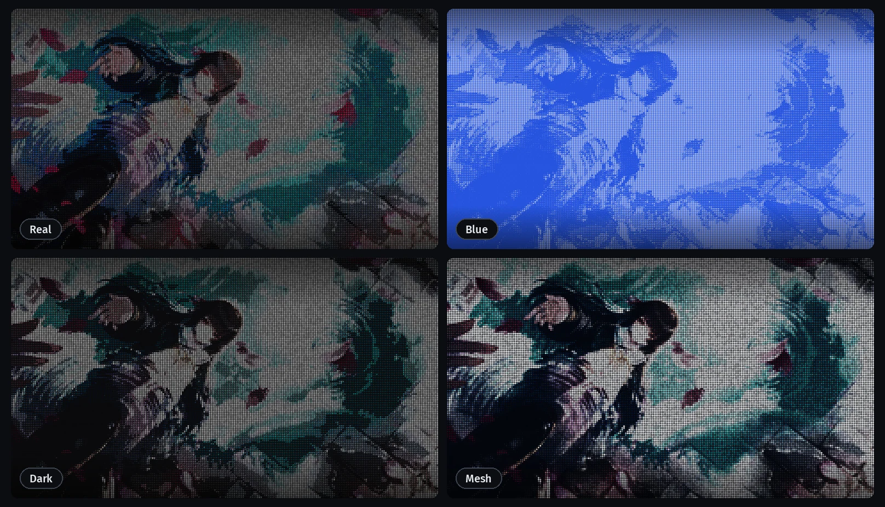
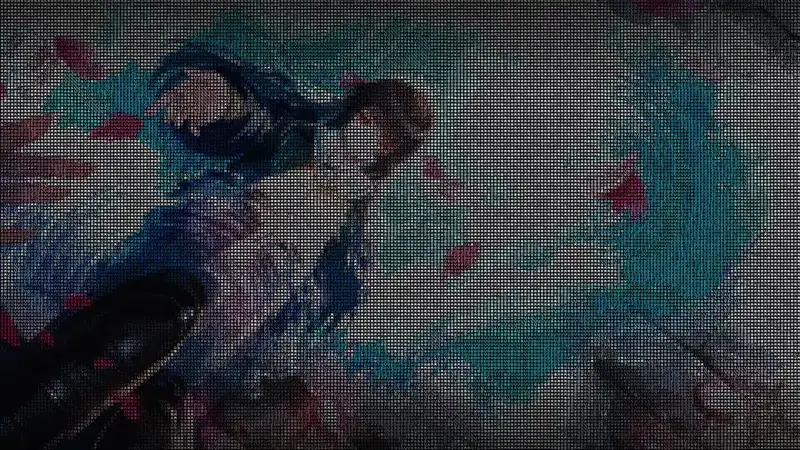

<p align="center">
  
</p>

<h1 align="center">ASCII Glyphscape</h1>

<p align="center">Any picture or video, redrawn in characters, as your Orca wallpaper.</p>

<p align="center">
  <a href="https://github.com/Nanangprasetya/ascii-glyphscape/tags"></a>
  <a href="#install"></a>
  <a href="#install"></a>
  <a href="LICENSE"></a>
</p>

<p align="center">
  <a href="#install">Install</a> ·
  <a href="#quick-start">Quick start</a> ·
  <a href="#in-orca">In Orca</a> ·
  <a href="#editor">Editor</a> ·
  <a href="#character-sets">Character sets</a> ·
  <a href="CHANGELOG.md">Changelog</a>
</p>

<p align="center">
  
</p>

ASCII Glyphscape is an Orca plugin that turns any picture or video into an ASCII-art wallpaper, with
a dark and a light theme, matching terminal colours and sidebars tuned to sit against the picture.
Choose from fifteen character sets and four looks, grade the colour, add looping motion, and see
every change in a live preview editor that opens in a tab of Orca's own browser. The renderer is a
port of the "ADE - ASCII Hover Dashboard" page, held to that page's own output by a golden test.

## Install

You need:

- **Orca 1.4.258** or newer.
- **Python 3 with Pillow**: `sudo pacman -S python-pillow` (Arch) or `sudo apt install python3-pil`
  (Debian, Ubuntu).
- **ffmpeg with libx264** for motion and video sources: `sudo pacman -S ffmpeg`. Pictures work
  without it.
- **kdialog** (KDE) or **zenity** for the file dialog. Without them, upload in the editor or type a
  path into the Source setting.

Install from GitHub:

```sh
orca plugin install Nanangprasetya/ascii-glyphscape
```

The plugin runs its own code (a worker and the Python renderer), so Orca first lists what it may do
and prints a fingerprint. Approve it by running the same command again with
`--approve <fingerprint>`.

On Linux, outside Orca's own terminals, run the CLI as `orca-ide`: a bare `orca` there is often the
GNOME screen reader.

To work on the plugin, load a clone as a development folder instead:

```sh
git clone https://github.com/Nanangprasetya/ascii-glyphscape.git
orca plugin dev load ./ascii-glyphscape                         # prints a fingerprint
orca plugin dev load ./ascii-glyphscape --approve <fingerprint>
```

## Quick start

1. Open the command palette and run **ASCII Glyphscape: Open editor (live preview)**.
2. Pick a source: the sample, **Upload**, **Browse files...**, or drop a picture or video on the
   preview.
3. Choose a look and a character set, then tune the colour. The preview follows every slider.
4. Press **Apply** (Ctrl+Enter). Both themes render in the background, and the **ASCII** item in the
   status bar shows the progress.
5. In **Settings > Appearance**, choose the theme **ASCII Glyphscape Dark** (or **Light**) and the
   terminal theme of the same name, and set **Background Opacity** below 1 (try 0.6).

Prefer the settings page? Everything the editor sets is also in **Settings > Plugins > ASCII
Glyphscape**, and every change there renders the themes again.

## In Orca

<p align="center">
  
</p>

Orca paints the wallpaper behind terminals and chats. The editor, the sidebars and the menus stay
solid, in colours taken from the same picture.

## Features

- **Four looks**: Real (original colour), Blue (halftone), Dark (dot matrix) and Mesh (diamond LED).
- **Fifteen character sets**: ASCII, Detailed, Blocks, Letter tiles, Sparse, Binary, Braille, Dots,
  Dither, Bricks, Particle, Film, Drift, Code and your own. Braille and Dither draw twice the grid's
  detail; Film, Particle and Drift follow an effect strength, and Drift runs in any of four
  directions.
- **Colour grading**: saturation, contrast, brightness, grain, a subject isolator (flat
  background), an ink tint (duotone), background and accent colours, top and bottom shade.
- **Motion**: a wandering hover glow with its trail, ripples, a scanline, glitch blocks and a slow
  breathe, each a seamless loop rendered to a video wallpaper.
- **Any source**: pictures (JPG, PNG, WebP, BMP, GIF, TIFF, AVIF) and videos (MP4, MOV, WebM, MKV,
  animated GIF). A video becomes an ASCII video wallpaper.
- **Both themes at once**: "ASCII Glyphscape Dark" and "ASCII Glyphscape Light", with terminal
  themes of the same names, delivered by a small companion plugin, **ASCII Glyphscape Output**,
  that this plugin writes and installs for you.
- **Sidebars that fit**: Orca cannot blur its sidebars, so the Sidebar settings match them to the
  wallpaper instead (see [About blurring the sidebar](#about-blurring-the-sidebar)).

<p align="center">
  
</p>

## Editor

**ASCII Glyphscape: Open editor** opens a page in a tab of Orca's own browser, not a sidebar.

<p align="center">
  
</p>

- A **live preview** of the wallpaper, drawn by the same renderer as the real themes, for the dark
  and the light theme. It updates as you move a slider, in a few hundred milliseconds.
- **1:1 detail**: a lens that shows the real full-size pixels under the pointer (press L).
- **Motion**: the loop, or the first seconds of a video, as an animated preview.
- **Character sets as a gallery**: every set drawn live on your picture at the real cell size.
  Click the preview to choose which spot the gallery shows.
- **Sources**: the sample and your library, with upload (button or drop a file on the page), the
  desktop's file dialog, and removing old files.
- Changes stay a draft (a dot marks each one) until **Apply** (Ctrl+Enter). Apply writes them to the
  plugin's settings and renders both themes at once. **Revert** drops the draft. When the settings
  change on Orca's Settings page meanwhile, the editor follows them, or asks first if you have
  changes of your own.

<table>
  <tr>
    <td width="50%"></td>
    <td width="50%"></td>
  </tr>
  <tr>
    <td align="center"><sub>1:1 detail shows the real pixels before you apply</sub></td>
    <td align="center"><sub>Colour grading and the light theme preview</sub></td>
  </tr>
</table>

Running the command again brings the same tab back. A tab Orca restores after a restart keeps
working.

## Character sets

<p align="center">
  
</p>

Detailed, Letter tiles and Film are sorted by the ink each glyph has in the chosen font. The pattern
sets (Braille, Dots, Dither, Bricks, Particle, Drift) draw their own tiles, so the motion effects
treat them like letters.

## Looks and motion

<p align="center">
  
</p>

<p align="center">
  
</p>

## Make the wallpaper visible

Orca only paints a theme's wallpaper when its own settings allow it:

1. **Settings > Appearance > Theme**: choose **ASCII Glyphscape Dark** or **ASCII Glyphscape
   Light** (listed under ASCII Glyphscape Output), and the terminal theme of the same name. The
   first render installs ASCII Glyphscape Output; choose the theme after that.
2. **Background Opacity** below 1 (try 0.6) under Settings > Appearance > Interface > Advanced and
   Terminal > Advanced. At 1 Orca paints no wallpaper at all.
3. **Reduce Visual Effects** off. A video plays while the Orca window has focus; otherwise Orca
   shows the still picture.

Run **ASCII Glyphscape: Show setup checklist** from the command palette to see this list together
with what was found on your machine.

## About blurring the sidebar

Orca does not let a theme blur its sidebars or make them see-through. Its theme tokens are a closed
list of solid colours, and Orca drops any surface colour with transparency or with text contrast
below 4.5:1. The wallpaper shows through terminals and chats only. So instead of a blur, the
**Sidebar** settings make the solid sidebars sit well against the wallpaper: match the background,
go deeper or lift it, and mix in the accent colour. Every generated colour is checked against
Orca's own rules before it is written, so none of them is silently dropped.

## Commands

| Command | What it does |
| --- | --- |
| ASCII Glyphscape: Open editor (live preview) | Opens the editor in a tab of Orca's browser, or brings its tab back. |
| ASCII Glyphscape: Choose image or video... | Opens a file dialog; the file is copied into the plugin's library and set as the source. |
| ASCII Glyphscape: Render now | Renders again even when nothing changed. Also a click on the status bar item. |
| ASCII Glyphscape: Cancel render | Stops the running render; the current themes stay as they are. |
| ASCII Glyphscape: Use the sample picture | Goes back to the sample picture after you chose a file. |
| ASCII Glyphscape: Reset settings | Puts every look setting back to its default. |
| ASCII Glyphscape: Show setup checklist | The steps above and what this machine has. |

## Limits (Orca's)

| | Picture | Video |
| --- | --- | --- |
| Format written | WebP | H.264 MP4, no audio |
| Size | at most 2 MB | at most 8 MB, 60 s |
| Pixels | 640x360 to 4096 a side | at most 1920x1200 |

ASCII art is dense, so a 4K picture rarely fits in 2 MB. The renderer then draws it again at the
largest size that fits (the character cells scale with it, so the look stays the same) rather than
shrinking a finished picture, and tells you what it changed.

## How it works

- `main.mjs` and `lib/` are the Orca worker. It reads the settings, and on a change (debounced)
  starts `tools/ascii_cli.py` as a detached process. Orca restarts a development plugin's worker
  whenever a file in its folder changes, so the render outlives the worker and reports through a
  job file in `~/.local/share/orca-ascii-themes/jobs/`. A restarted worker picks the job up from
  there. A render whose settings and source did not change is skipped.
- `tools/` is the renderer (Python, Pillow, no numpy). `ascii_core.py` is the page's maths, held to
  the page's own answers by a golden test. `ascii_glyphs.py` adds the plugin's character sets on
  top of it: cellStyle() still picks per cell, so every look keeps its colours. The pattern sets
  draw their own tiles as private-use characters, so the compositor and the motion effects treat
  them like letters. A frame is composed in layers inside Pillow's C code (one layer per glyph), so
  a full 4K frame takes well under a second; video frames are drawn by a pool of worker processes
  and streamed to ffmpeg.
- The themes are written into a small content-only plugin, the theme pack, in
  `~/.local/share/orca-ascii-themes/theme-pack` (or the folder named in Advanced > theme output
  folder), never into this plugin's folder. After each render the worker installs that folder
  again (`orca plugin update local.ascii-themes-output`). Orca serves a theme's wallpaper at a URL
  made of the plugin's content hash; a development folder has none, so its URL never changes and
  Orca keeps showing the first picture it loaded. An installed plugin gets a new hash, and so a new
  URL, with every render. A content-only plugin installs without approval, and Orca keeps only the
  current copy and the one before it.
- The editor is served by a small HTTP server in the worker (`lib/editor-server.mjs`) and opened
  with Orca's CLI (`orca tab create`). The server listens on 127.0.0.1 only, answers only its own
  Host, needs a random 128-bit token in every path, takes requests only from its own origin with a
  JSON or binary content type, and serves pages under a strict content security policy. Its port
  and token are kept in the data folder (`editor.json`).
- Previews come from `tools/ascii_preview.py`, a Python process that stays up while the editor is
  used (fonts, the source and the last full-size render stay loaded) and stops after ten idle
  minutes. Only the newest request of each kind waits for it, so dragging a slider never queues
  old previews. A test holds the preview to the same pixels as a real render.
- Media files get content-hash names, and the theme JSON is switched to them last, atomically.
  Earlier renders are removed. `assets/pack/` holds the starting themes a new pack is made from.

## Contributing

Issues and pull requests are welcome. To work on the plugin:

```sh
node --test test/*.test.mjs          # worker tests (includes a real render)
python3 -I -B tools/test_ascii.py    # renderer tests (golden port, compositing, budgets, loops, themes)
node scripts/sync-manifest.mjs       # after changing settings, commands or themes
node tools/golden/make_golden.mjs    # regenerates the page's reference answers
orca plugin validate . && orca plugin check .
orca plugin dev watch .              # loads the folder and streams its logs
```

Commit messages follow [Conventional Commits](https://www.conventionalcommits.org/en/v1.0.0/), and
every release is listed in [CHANGELOG.md](CHANGELOG.md).

## License

[MIT](LICENSE) © Nanangprasetya
